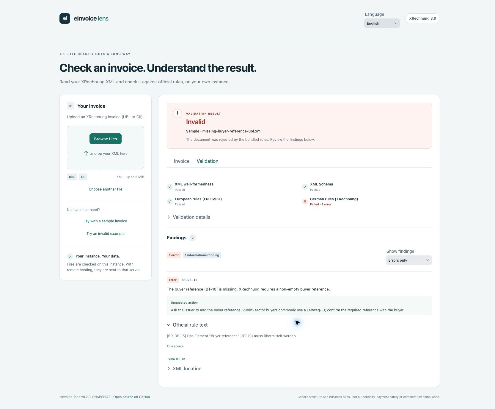

# einvoice-lens

Understand German e-invoices and their validation errors—with readable invoices,
clear explanations, and local processing.

**Status: readable invoices, explanations and bilingual UI · v0.2.0.** Upload an XRechnung XML
or try a bundled sample. The **Invoice** tab shows parties, dates, lines, VAT,
allowances/charges, supplied totals and payment details. The **Validation** tab keeps
rule findings, severity filters and XML locations. Where a business term has one clear
location, a finding can jump to its invoice field. Seven reviewed DE/EN explanations
cover the current sample findings, including missing buyer references and inconsistent
totals. The unchanged official rule text remains expandable below each explanation.
Unknown rules fall back explicitly. Report export remains planned.



*The bundled invalid sample: understand the finding and see what to correct.*

## Run locally

Requires JDK 21. The Maven wrapper downloads Maven on first use. Frontend development
uses Node.js 24+; Vaadin can download a compatible Node version during the build.
Build and development need internet access.

```sh
./mvnw verify
./mvnw install -DskipTests
./mvnw -pl lens-app spring-boot:run
```

Open <http://localhost:8080>. The application binds to loopback by default.
The footer reads its version from Maven build metadata and links to
[the GitHub repository](https://github.com/limajr/einvoice-lens). Deployments can override
`lens.repository-url`; the rule-version tooltip identifies the bundled configuration.
The install step makes the sibling modules available to the app-only run command.
On Windows, use `mvnw.cmd` in place of `./mvnw`.

To build and run a self-contained production application:

```sh
./mvnw -Pproduction verify
java -jar lens-app/target/lens-app-0.2.0.jar
```

## Try sample invoices

Click **Try with a sample invoice** for a valid bundled KoSIT example, or **Try an
invalid example** for an invoice missing its buyer reference. Both run through the
same validator as uploads, without downloading a file first.

The top-level [Sample folder](Sample/README.md) contains ten ready-to-upload XML invoices:
standard and minimal UBL/CII examples, comprehensive examples, and deliberately invalid
invoices. Its guide lists the expected verdict and rule IDs for each file.

## Supported scope

Standard XRechnung 3.0 UBL Invoice and CII XML are checked with KoSIT Validator 1.6.3
and configuration 3.0.2 / 2026-08-31 (EN16931 1.3.16). Other profiles, extensions,
UBL CreditNote and PDFs are unsupported. If a recognized syntax has a missing profile,
the reader can still show partial data while rule validation remains unsupported.

The reader preserves source amounts and decimal precision, displays missing fields,
and flags values it cannot interpret. Choose **English** or **Deutsch** in the header's
**Language / Sprache** selector for the UI, explanations and code labels. The independent
**Display format / Anzeigeformat** selector controls dates and amounts. By default it
follows the UI language, while an explicit format choice is retained. Currency amounts use
standard minor-unit digits while retaining additional meaningful decimals, without
rounding. The raw XML text and BT codes remain available on hover. Invoice content and
official validator messages are never translated. Validation and reading are independent: an invalid
invoice can still be read, and an unreadable file never receives a valid verdict
because of display parsing. Supplied totals are never silently corrected or replaced. A separate **Line totals
consistent / Line totals differ** display check compares the exact sum of line net amounts
with the stated line subtotal. It does not change the official validation result.

Payment accounts recognized as IBANs are grouped in fours; **Copy** copies the unspaced
identifier. Invoice note subject codes appear as small labels, and duplicate line item
text is suppressed. Display labels cover a reviewed subset of the official code lists;
unknown codes remain visible. See [code-list sources](lens-explain/src/main/resources/CODE_LISTS.md).

The readable view covers the main invoice fields, not every EN16931 term. Supporting
documents are counted but attachments are not opened or downloaded. See the
[reader scope and field mapping](docs/INVOICE_READER.md), [roadmap](docs/ROADMAP.md) and
[v0.2.0 release notes](CHANGELOG.md). ZUGFeRD/Factur-X PDFs, a larger explanation catalog, HTML reports and Docker packaging
remain later work. See [explanation provenance](lens-explain/src/main/resources/EXPLANATIONS.md).

## Structure

- `lens-core`: framework-independent domain and validation code.
- `lens-explain`: versioned explanations and business-term metadata.
- `lens-app`: Spring Boot and Vaadin Flow application.

Java 21 · Spring Boot 4.1.2 · Vaadin 25.3.4 · Maven 3.9.11.

## Processing and trust

Validation runs on your own instance using bundled rule resources. With remote
self-hosting, invoices travel to that server. The application retains parsed invoice data and findings in the
current UI session until cleared or expired, and has no invoice database. Clear or remove
a file to clear the displayed invoice and findings. The servlet container may use temporary upload
files; this is not a verified memory-only deployment. Public rule resources are extracted
to a temporary directory at startup and removed on orderly shutdown.

Uploads are limited to 5 MiB on the server. DTDs, external schema hints, XInclude,
processing instructions and xml:base are rejected. XML depth, attribute and element
counts are bounded. There is one validation worker per application instance and no
queued jobs. A 30-second deadline returns an incomplete result; if a library ignores
interruption, its worker remains occupied and further requests report busy until it
finishes. This is a response deadline, not process isolation.

Results distinguish valid, warnings, invalid, unsupported and incomplete checks. Each
rule result shows engine/bundle provenance and executed checks. Stage icons and counts
are derived from messages in that stage: red failures, amber warnings, grey information,
green passes and a separate not-run state. Results do not establish
payment safety, authenticity, or complete tax/legal compliance. This project does not
provide tax or legal advice. Keep this preview on a trusted local instance.

## Test fixtures

A pinned KoSIT XML subset and targeted invalid mutations are available with
[provenance and reproduction instructions](lens-core/src/test/resources/samples/SOURCES.md).
The optional `python3 scripts/check-fixtures.py --download-tools` command verifies them
against the official CLI. `./mvnw verify` now also checks the Java adapter against
all ten pinned examples, plus malformed/adversarial XML, unsupported profiles, size
limits, engine failures and deadline/concurrency behavior. Parser tests compare UBL/CII
business values, preserve invalid fields and original totals, verify repeated groups and
currencies, and exercise namespace changes, decimal precision and reader hardening. This is a selected corpus,
not certification or coverage of the entire official test suite.

## License

Original project code is [MIT licensed](LICENSE). Dependencies retain their own
licenses; see [third-party information](THIRD_PARTY.md).
